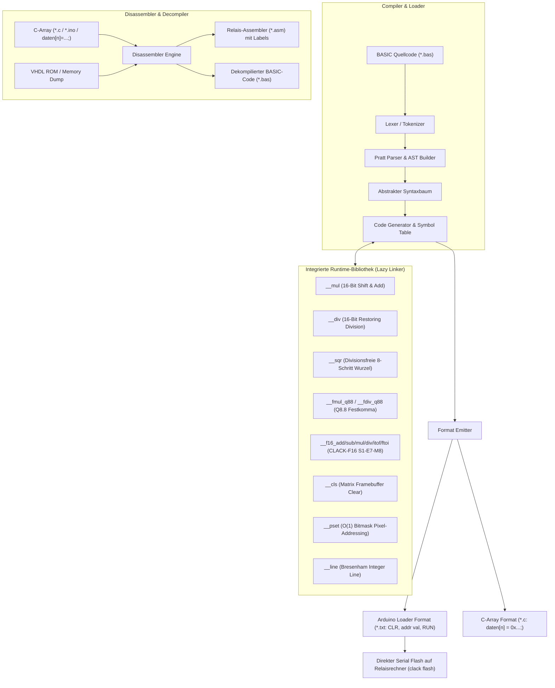

# ⚡ Clack-BASIC & Disassembler Suite (v1.5.4)
**16-Bit Relaisrechner Cross-Compiler, Disassembler & Decompiler CLI**

Ein moderner, hochperformanter **BASIC Cross-Compiler, Assembler und Disassembler in Go**, der höheren BASIC-Quellcode in optimierten 16-Bit Maschinencode für den mechanischen Relais-Computer übersetzt sowie rohe C-Arrays und Maschinencode in sauberen Assembler und BASIC dekompiliert.

---

## 🏛️ Compiler & Decompiler Pipeline



---

## 🚀 CLI Befehle

### 1. BASIC in Maschinencode kompilieren (`clack compile`)
```bash
# Standard Arduino Loader Format (addr val):
clack compile examples/math_test.bas -o math_test.txt

# Als C-Array für Arduino-Sketches:
clack compile examples/mandelbrot.bas --format=c-array -o mandelbrot.c
```

### 2. Assembler übersetzen (`clack asm`)
```bash
clack asm program.asm -o program.txt
```

### 3. C-Arrays & Maschinencode disassemblieren (`clack disasm`)
Konvertiert rohe C-Arrays (`daten[n] = 0x...;`), `.ino` Sketches oder Speicherdumps in sauberen, gelabelten 16-Bit Relais-Assembler:
```bash
clack disasm division.c -o division.asm
```
* **Automatische Subroutinen:** Erkennt Aufrufe (`CALL 11`) und setzt `SUB_11:`.
* **Automatische Sprungziele:** Erkennt bedingte und unbedingte Sprünge (`BZ 83`) und setzt `LABEL_83:`.
* **Kommentar-Erhalt:** Behält alle Inline-Kommentare (`// Bitposition`, `// TMP`) 1:1 bei.
* **ORG Segmentierung:** Teilt lückenhafte Speicherbereiche automatisch in `ORG <adresse>` Segmente auf.

### 4. Maschinencode in BASIC dekompilieren (`clack decompile`)
```bash
clack decompile program.txt -o program.bas
```

### 5. Direkt auf den Relaisrechner flashen (`clack flash`)
```bash
clack flash program.txt -p /dev/ttyACM0
```

---

## 📖 Unterstützter BASIC Sprachumfang

* **3 Numerische 16-Bit Datentypen:**
  * **`INT16` (Standard-Ganzzahl):** `-32768 .. +32767` (`LET A = 25`, `DIM A AS INT16`)
  * **`FIXED8` (`Q8.8` Festkomma):** `-128.0000 .. +127.9961` bei Auflösung `1/256 = 0.00390625` (`DIM X, Y AS FIXED8` oder `AS Q8.8`). Addition/Subtraktion laufen direkt inline in 2 ALU-Befehlen; Multiplikation/Division binden `__runtime_fmul_q88` bzw. `__runtime_fdiv_q88` ein.
  * **`FLOAT16` (`CLACK-F16` Gleitkomma im Zuse-Stil `S1-E7-M8`):** 1 Bit Vorzeichen, 7 Bit Exponent (Bias 63), 8 Bit Mantisse mit impliziter führender `1` (9 Bit Präzision, Dynamikbereich `±5.4×10⁻²⁰ .. ±9.2×10¹⁸`, kanonische Null `0x0000`). Deklaration per `#`-Suffix (`X# = 1.5`, `Y# = 2.25`) oder `DIM Z AS FLOAT16` (auch `AS CLACK-F16` / `AS F16`).
* **Arithmetik, Wurzel & Bitoperationen:** `+`, `-`, `*`, `/`, `MOD`, `SQR(X)` / `SQR(X, DEC)`, `SHL`, `SHR`, `AND`, `OR`, `NOT`, `XOR`
* **Typkonvertierung & Explizite FPU-Intrinsics:**
  * Konvertierung: `FTOI(x)`, `INT(x)`, `FIX(x)`, `F16TOI(x)` (nach `INT16`), `ITOF(n)`, `FIXED8(n)` (nach `Q8.8`), `ITOF16(n)`, `FLOAT16(n)` (nach `CLACK-F16`), automatische Typ-Promotion in gemischten Ausdrücken.
  * Explizite Funktionen: `FADD`, `FSUB`, `FMUL`, `FDIV`, `FCMP`, `FABS`, `FNEG` (`Q8.8`) sowie `F16ADD`, `F16SUB`, `F16MUL`, `F16DIV`, `F16CMP`, `F16ABS`, `F16NEG` (`CLACK-F16`) und polymorphes `ABS(x)`.
* **Kontrollstrukturen:** `IF..THEN..ELSE..END IF` (direktes Branching für `INT16`, `FIXED8`, `FLOAT16`), `FOR..TO..STEP..NEXT` (inkl. negativer `STEP`-Werte), `GOTO`, `GOSUB..RETURN`, `STOP`
* **Datentabellen & Ausgabe:** `DATA 10, 20, 30`, `READ X, Y`, `RESTORE`, `PRINT "Text"; X`
* **Direkter Speicherzugriff:** `POKE addr, val`, `PEEK(addr)`
* **Grafikausgabe & Animation (LED Matrix 64×64 / 32×32):**
  * `SCREEN 32` / `SCREEN 64` (Auflösung und Framebuffer-Basisadresse)
  * `CLS [StartRow, EndRow]` (Display / Zeilen löschen)
  * `PLOT X, Y [, Color]` / `PSET X, Y, Color` (Pixel punktgenau per `O(1)` Bitmasken-Tabelle setzen / löschen)
  * `LINE X1, Y1 TO X2, Y2 [, Color]` (Bresenham-Linien beliebiger Steigung)
  * `PIXELMOVE X1, Y1 TO X2, Y2 [, Color]` / `PIXELMOVE X, Y BY DX, DY` (Flimmerfreie Punkt-Animation)
  * *Ausführliche Dokumentation:* Siehe [docs/BASIC_GRAPHICS_AND_CONTROL.md](docs/BASIC_GRAPHICS_AND_CONTROL.md) und [docs/FLOATING_POINT_KONZEPT.md](docs/FLOATING_POINT_KONZEPT.md)

---

## 📦 Multi-Platform Binaries

Unter den [Releases auf Forgejo](https://git.latentforge.dev/relay-computing/clack-basic/releases):
- 🐧 **Linux (x86_64):** `clack-linux-amd64`
- 🪟 **Windows (x64):** `clack-windows-amd64.exe`
- 🍏 **macOS Apple Silicon (ARM64):** `clack-darwin-arm64`
- 🍏 **macOS Intel (x64):** `clack-darwin-amd64`
