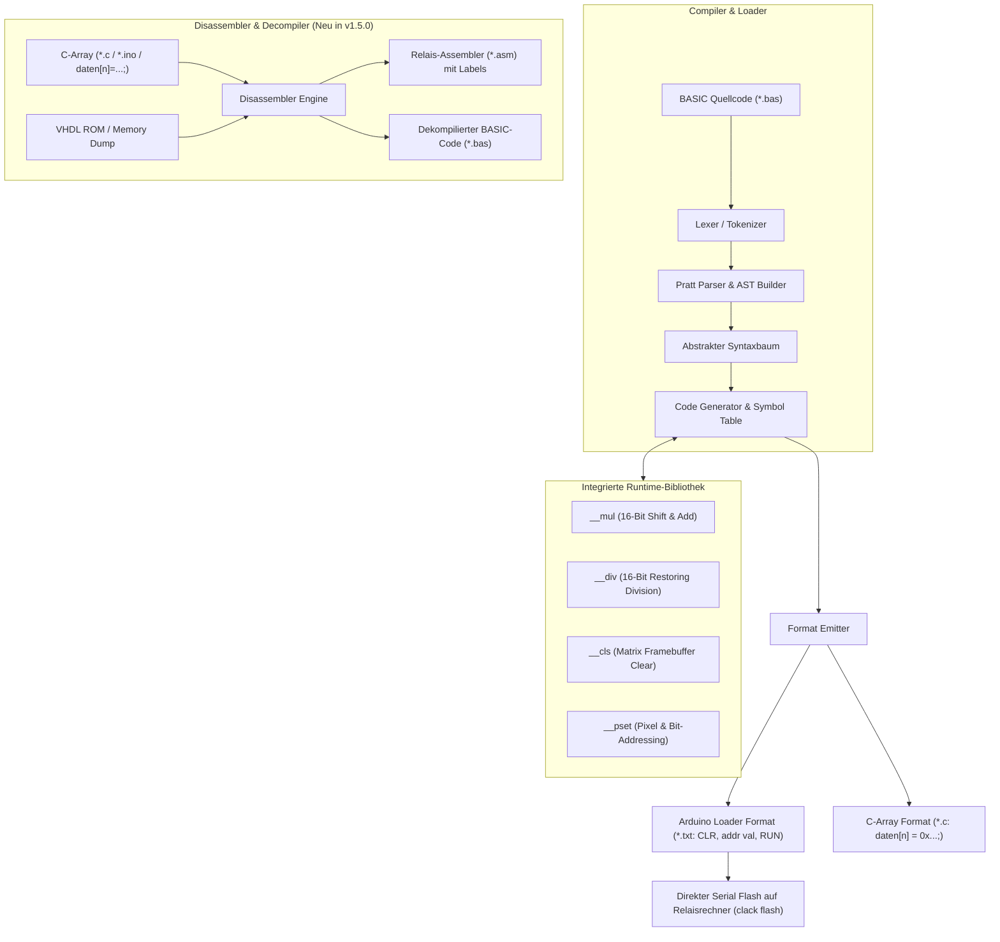

# ⚡ Clack-BASIC & Disassembler Suite (v1.5.0)
**16-Bit Relaisrechner Cross-Compiler, Disassembler & Decompiler CLI**

Ein moderner, hochperformanter **BASIC Cross-Compiler, Assembler und Disassembler in Go**, der höheren BASIC-Quellcode in optimierten 16-Bit Maschinencode für den mechanischen Relais-Computer übersetzt sowie rohe C-Arrays und Maschinencode in sauberen Assembler und BASIC dekompiliert.

---

## 🏛️ Compiler & Decompiler Pipeline



---

## 🚀 CLI Befehle

### 1. BASIC in Maschinencode kompilieren (`clack compile`)
```bash
# Standard Arduino Loader Format (addr val):
clack compile examples/math_test.bas -o math_test.txt

# Als C-Array für Arduino-Sketches:
clack compile examples/mandelbrot.bas --format=c-array -o mandelbrot.c
```

### 2. Assembler übersetzen (`clack asm`)
```bash
clack asm program.asm -o program.txt
```

### 3. C-Arrays & Maschinencode disassemblieren (`clack disasm`)
Konvertiert rohe C-Arrays (`daten[n] = 0x...;`), `.ino` Sketches oder Speicherdumps in sauberen, gelabelten 16-Bit Relais-Assembler:
```bash
clack disasm division.c -o division.asm
```
* **Automatische Subroutinen:** Erkennt Aufrufe (`CALL 11`) und setzt `SUB_11:`.
* **Automatische Sprungziele:** Erkennt bedingte und unbedingte Sprünge (`BZ 83`) und setzt `LABEL_83:`.
* **Kommentar-Erhalt:** Behält alle Inline-Kommentare (`// Bitposition`, `// TMP`) 1:1 bei.
* **ORG Segmentierung:** Teilt lückenhafte Speicherbereiche automatisch in `ORG <adresse>` Segmente auf.

### 4. Maschinencode in BASIC dekompilieren (`clack decompile`)
```bash
clack decompile program.txt -o program.bas
```

### 5. Direkt auf den Relaisrechner flashen (`clack flash`)
```bash
clack flash program.txt -p /dev/ttyACM0
```

---

## 📖 Unterstützter BASIC Sprachumfang

* **Variablen & Zuweisungen:** `LET A = 25`, `LET B = A * 4 + 10`
* **Arithmetik & Bitoperationen:** `+`, `-`, `*`, `/`, `MOD`, `SHL`, `SHR`, `AND`, `OR`, `NOT`, `XOR`
* **Kontrollstrukturen:** `IF..THEN..ELSE..END IF`, `FOR..TO..STEP..NEXT`, `GOTO`, `GOSUB..RETURN`
* **Datentabellen:** `DATA 10, 20, 30`, `READ X, Y`, `RESTORE`
* **Direkter Speicherzugriff:** `POKE addr, val`, `PEEK(addr)`
* **Grafikausgabe:** `CLS`, `PSET X, Y, color`

---

## 📦 Multi-Platform Binaries

Unter den [Releases auf Forgejo](https://git.latentforge.dev/relay-computing/clack-basic/releases):
- 🐧 **Linux (x86_64):** `clack-linux-amd64`
- 🪟 **Windows (x64):** `clack-windows-amd64.exe`
- 🍏 **macOS Apple Silicon (ARM64):** `clack-darwin-arm64`
- 🍏 **macOS Intel (x64):** `clack-darwin-amd64`
