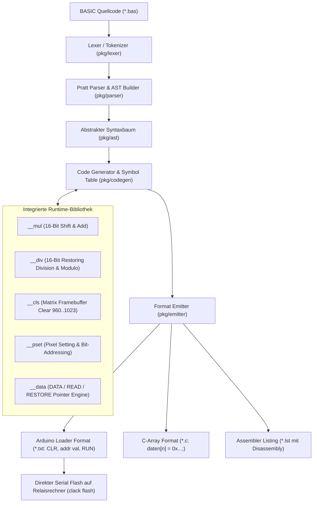

# ⚡ Clack-BASIC: 16-Bit Relaisrechner Cross-Compiler

Ein moderner, hochperformanter **BASIC Cross-Compiler in Go**, der höheren BASIC-Quellcode in optimierten 16-Bit Maschinencode für den mechanischen Relais-Computer übersetzt.

---

## 🏛️ Compiler-Pipeline



---

## 📖 Unterstützter Sprachumfang

### 1. Variablen & Zuweisungen
```basic
LET A = 25
LET B = A * 4 + 10
COUNTER = COUNTER + 1
```

### 2. Arithmetik & Bitoperationen
* **Addition & Subtraktion:** `+`, `-` (über 2er-Komplement $A + \sim B + 1$)
* **Multiplikation:** `*` (automatisch über Hardware-optimierte `__mul` Subroutine)
* **Division & Modulo:** `/`, `MOD` (automatisch über Hardware-optimierte `__div` Subroutine)
* **Bit-Shifts:** `SHL` (Linksshift), `SHR` (Rechtsshift)
* **Logik:** `AND`, `OR`, `NOT`, `XOR`

### 3. Kontrollstrukturen & Schleifen
```basic
IF A > 10 THEN
    LET B = 1
ELSE
    LET B = 0
END IF

FOR I = 0 TO 15 STEP 1
    PSET I, I, 0xFFFF
NEXT I

GOTO MEIN_LABEL
GOSUB 500
RETURN
```

### 4. Datentabellen & Speicherzugriffe
```basic
DATA 10, 20, 30, 40
READ X, Y
RESTORE

POKE 700, 0x1234
LET V = PEEK(700)
```

### 5. Memory-Mapped Display-Grafik (4x Matrix / 1024 Pixel ab Adresse 960)
```basic
CLS                  ' Löscht den Display-Bereich 960..1023
PSET X, Y, 0xFFFF    ' Setzt Pixel auf der LED-Matrix
```

---

## 🛠️ Installation & Verwendung

### Kompilieren des Compilers:
```bash
cd clack-basic
go build -o bin/clack .
```

### Befehle:

```bash
# 1. BASIC-Programm in Maschinencode kompilieren (Standard: Arduino Loader Format)
./bin/clack compile examples/math_test.bas -o math_test.txt

# 2. Assembler-Code in Maschinencode assemblieren
./bin/clack asm examples/bounce.asm -o bounce.txt

# 3. Maschinencode oder Assembler nach Clack-BASIC dekompilieren!
./bin/clack decompile CollatzReihe.txt -o collatz.bas
./bin/clack decompile bounce.asm -o bounce.bas

# 4. In Assembler-Listing mit Disassembly kompilieren
./bin/clack compile examples/math_test.bas --format=listing

# 5. In C-Array für Simulation kompilieren
./bin/clack compile examples/math_test.bas --format=c-array

# 6. Direkt auf den Relais-Computer flashen (mit Auto-Port-Erkennung)
./bin/clack flash examples/graphics_demo.bas -m
```

---

## 📊 Benchmark & Performance

* **Kompilierzeit:** $< 0.1 \text{ ms}$ für 200 Zeilen BASIC-Code.
* **Speicheroverhead:** Minimal durch modulares Einbinden von Subroutinen (nur benötigte Runtime-Routinen werden kompiliert).
