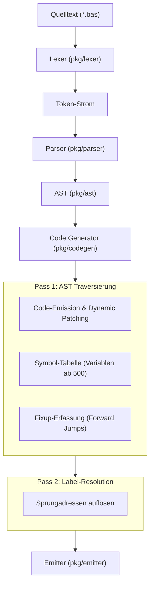

# 🏛️ Compiler-Architektur & Pipeline

Der **Clack-BASIC Compiler** ist als modularer Single-Pass / Two-Pass Cross-Compiler in Go implementiert.

---

## 1. Architekturübersicht

---

## 2. Speicher-Layout des generierten Maschinencodes

| Speicherbereich | Typ | Beschreibung |
| :--- | :---: | :--- |
| **`0x000` .. `0x009` (0..9)** | Boot / Reset | Initialer Sprung `0 0x4000`, Sprungziel zum Start des Hauptprogramms |
| **`0x00A` .. Code-Ende** | Programmcode | Übersetzte BASIC-Statements (`LET`, `IF`, `FOR`, `GOTO`, `CALL`, etc.) |
| **Nach Hauptprogramm** | Subroutinen | Bedarfsweise eingebundene Runtime-Bibliothek (`__mul`, `__div`, `__cls`, `__pset`) |
| **Vor Datenbereich** | DATA-Tabelle | Konstanten-Tabelle für `DATA`, `READ`, `RESTORE` |
| **`0x1F4` .. `0x2BC` (500..699)** | Variablen | Dedizierte 16-Bit RAM-Zellen für Variablen (`A`, `B`, `COUNTER`, etc.) |
| **`0x2BC` .. `0x3BF` (700..959)** | Scratch / Temp | Temporäre Zellen für Zwischenergebnisse und Dynamic Patching |
| **`0x3C0` .. `0x3FF` (960..1023)**| Display-Matrix| 64 Worte (1024 Pixel) für 4x LED-Matrix Displays |
